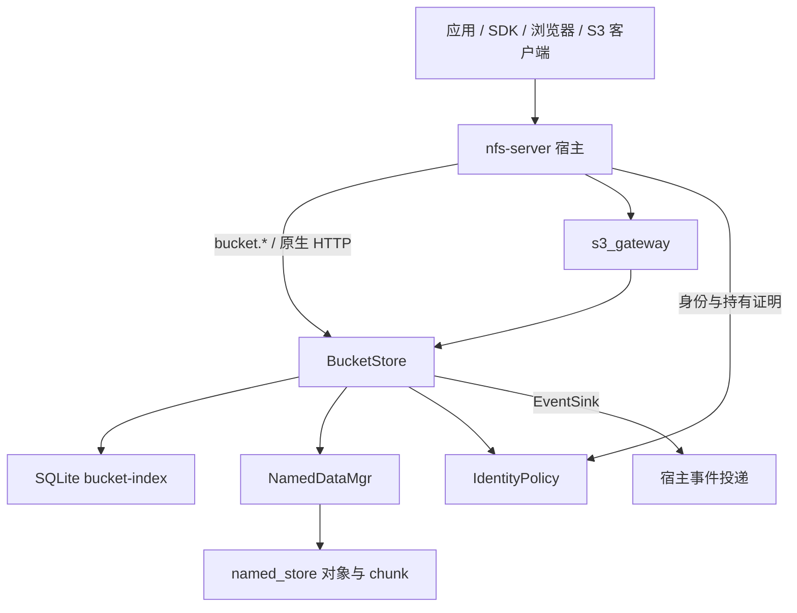

# BucketStore 设计与实现

> 版本：v1，首版实现说明；日期：2026-10-26
>
> 实现：[src/bucket_store](../src/bucket_store/)
>
> 上游设计：[BuckyOS 应用对象桶（Bucket）设计](../../buckyos/doc/arch/应用对象桶%20Bucket%20设计.md)
>
> 本文以当前源码为准，说明库的模型、事务边界、主要流程和接入方式；上游文档中的产品规划不等于本库已经提供的能力。

## 1. 定位与职责

`bucket_store` 在 Named Data 之上提供应用级的可变命名空间：

```text
(bucket_id, key, version) → ObjId + 绑定元数据
```

索引回答“哪个应用、哪个用户，以什么名字引用哪些内容”；数据策略决定这条引用是否承担保留责任，以及采用哪一种 pin。内容正文和 chunk 仍由 `named_store` 存储，Bucket 不建立第二套文件存储。复制绑定可以复用同一 ObjId，不复制内容字节。

这里的 **应用 Bucket** 与 `NamedStoreMgr` 用于放置数据的 **store bucket / 分片** 是两个概念：前者按应用、用户和用途组织名字与保留承诺；后者按内容 ID 决定实际存储位置。

### 1.1 组件关系



| 层 | 当前职责 |
| --- | --- |
| `bucket_store` | 索引、版本、条件写、pin 协调、grant / 能力令牌、配额、生命周期、快照、HTTP 响应构造；保存 S3 密钥和 multipart 会话 |
| `named_store` / `NamedDataMgr` | 内容寻址读写、完整性检查、pin / unpin、引用级联、outbox、LRU 与 GC |
| `s3_gateway` | S3 请求路由、SigV4、XML、ETag 转换和 multipart 编排 |
| nfs-server 宿主 | 身份认证与 RBAC、声明同步和懒建桶、kRPC / HTTP 路由、上传持有证明、后台任务、事件投递 |

`bucket_store` 是嵌入式 Rust 库，不启动独立服务，也不读取 BuckyOS 的 system-config。入口为 `BucketStore::new(IndexDb, NamedDataMgr) -> Arc<BucketStore>`。宿主构造 `Caller` 并实现 `IdentityPolicy`；库只匹配传入的用户、应用、Agent、群组等身份字符串。

### 1.2 源码地图

下表路径均相对于 [src/bucket_store/src](../src/bucket_store/src/)：

| 文件 | 主要内容 |
| --- | --- |
| `types.rs` | BucketId、声明、六档策略、Binding、请求和返回类型、限制常量 |
| `db.rs` | SQLite schema、事务封装、行与 Rust 类型转换 |
| `store.rs` | 桶管理、查询、put / delete / copy / batch、版本、计数和 pin 状态转换 |
| `access.rs` | 身份策略接口、授权判定、创建者约束、grant、`bkt_` 令牌 |
| `quota.rs` | 桶与资源池配额、使用量报表、计数重算、阈值事件 |
| `reconcile.rs` | 索引与实际 pin 对账、快照根修复、内容缺失检查 |
| `lifecycle.rs` | TTL、历史版本清理、delete marker 清理、cache LRU |
| `snapshot.rs` | manifest、派生目录树、快照注册、恢复和引用核验 |
| `http.rs` / `content.rs` | HTTP 数据面辅助、字节与 FileObject / ChunkList 的转换 |
| `s3.rs` | S3 密钥、multipart 上传和分段的持久化接口 |
| `events.rs` / `error.rs` | 事件接口、结构化错误及 HTTP 映射 |
| `tests.rs` | 隔离 NamedDataMgr 下的集成单测 |

## 2. 数据模型

### 2.1 桶、key、version 与 ObjId

```text
bucket_id = <scope>/<appid>/<owner>/<name>

user/photos.app.bns.did/alice/library
zone/homestation/_/published

obj://bucket/<bucket_id>/<key>             权限资源
/bucket/v1/<bucket_id>/<key>               原生 HTTP 数据面
```

`scope` 为 `user` 或 `zone`，默认 `user`。zone 桶的 owner 固定为 `_`，user 桶不能使用 `_`。appid、owner、name 各为 1–128 字节，仅允许 ASCII 字母、数字、`.`、`_`、`-`，且不能是 `.` 或 `..`。

key 是扁平字符串，不是文件系统路径：长度为 1–1024 个 UTF-8 字节，不能以 `/` 开头、包含 NUL 或独立的 `..` 段。`/` 用于前缀与 delimiter 列举，不提供目录 inode、子树 rename、append 或随机写语义。

| 标识 | 实际含义 |
| --- | --- |
| key | 桶内可覆盖的名字；不指定 version 时读取当前绑定 |
| version | **桶级递增**的整数序列；未开启版本保留的桶每次 PUT 也分配新 version |
| ObjId | 不可变内容身份；同一内容可以被多个 key、版本或桶引用 |

单独记录 ObjId 不授予读取权，也不建立保留责任。Binding 的 ObjId 通过新写入替换；`set_metadata` 则可以原地修改当前绑定的 Content-Type、metadata 和 tags，不生成新版本、不改变 ObjId。

### 2.2 kind 与绑定内容

| kind | 接受的对象 | 读取形态 |
| --- | --- | --- |
| `data` | `cyfile` / `cydir` | FileObject 返回文件字节；DirObject 返回对象正文 |
| `object` | 其他具名对象类型 | 对象正文，默认 `application/cyfs+json` |

裸 Chunk 和 ChunkList 都不能直接作为绑定值，文件字节须先封装为 FileObject。`describe` 从本地对象正文计算逻辑大小：FileObject 使用 `size`，DirObject 使用 `total_size`，其他对象使用正文的字节数。

Binding 除定位字段外，还保存 `obj_type`、`size`、`content_type`、`metadata`、`tags`、HTTP 缓存头、`expires_at`、`origin`、创建者和时间。原生 `etag` 为 ObjId；`etag_md5` 单独保存 S3 的 MD5 形式。用户 metadata 的 key/value 字节数合计最多 2048，tags 最多 10 个。

时间戳（如 `created_at`、`expires_at`、`origin.collected_at`）使用 Unix 毫秒；声明中的 TTL 单位为天，索引中的默认 TTL 单位为秒。

### 2.3 声明与六档数据策略

`BucketDecl` 必填 `kind` 和 `data_policy`，另有 scope、versioning、quota_mib、max_objects、default_ttl_days、lifecycle。策略由 [types.rs](../src/bucket_store/src/types.rs) 的 `DataPolicy` 方法集中定义。

| data_policy | pin | 资源池 | 默认版本保留 | TTL / 生命周期约束 |
| --- | --- | --- | --- | --- |
| `documents` | Recursive | user | 开，可关闭 | 禁对象 TTL 与默认 TTL；只接受历史版本过期规则 |
| `collected` | Recursive | user | 开，可关闭 | 同 documents，且必须提供 origin |
| `app_data` | Recursive | app | 关，可开启 | 可设对象 TTL，不能声明默认 TTL；接受三种生命周期规则 |
| `ambient` | Skeleton | 无 | 关，不可开启 | 必须提供 origin；可设默认 TTL 和生命周期；桶字节配额为软限 |
| `temp` | Recursive | app | 关，不可开启 | 必须声明 1–30 天默认 TTL；对象到期不晚于写入时刻加 30 天；不接受生命周期规则 |
| `cache` | 不 pin | 无 | 关，不可开启 | 可设默认 TTL 和生命周期；桶字节配额为软限 |

`documents` / `collected` 不接受声明级 `quota_mib`。temp 默认单对象上限为 2 GiB，cache 为 256 MiB，可通过配额配置覆盖；这些是绑定层限制，原生 HTTP 单次上传另有 32 MiB 限制。

`origin` 包含 author、source、collected_at 和可选 proof。当前仅检查 author 是 DID，source 以 `cyfs://`、`obj://` 或 `did:` 开头，不验证 proof。ambient 允许内容子树不完整，但绑定时描述对象正文必须存在。

Skeleton 的实际语义由底层 GC 决定：保护对象自身，并作为子项展开的硬屏障，不能把它解释为 Recursive 的弱化版本。参见 [named_store GC 方案](GC/named_store_gc.md)。

`ensure_bucket` 创建声明中的桶，或更新已有桶的 versioning、配额、默认 TTL 和生命周期等可变字段。kind / data_policy 发生变化时保留旧值并记录警告；scope 必须与 BucketId 匹配。移除声明通过 `mark_orphaned` 标记，不直接删除绑定。

## 3. 索引、锁与事务

### 3.1 SQLite 表

完整字段以 [db.rs 的 SCHEMA](../src/bucket_store/src/db.rs) 为准。

| 表 | 键 / 作用 |
| --- | --- |
| `buckets` | bucket_id 主键；声明、version_seq、使用量、孤儿标记 |
| `bindings` | `(bucket_id, key, version)` 主键；当前/历史绑定、delete marker、noncurrent_at |
| `bucket_pins` | `(bucket_id, obj_id)` 主键；ref_count、held / releasing 状态 |
| `bucket_grants` | grant_id 主键；主体、前缀、动作与有效期 |
| `bucket_access_tokens` | token_id 主键、token_hash 唯一索引；范围、次数、绑定身份和撤销时间 |
| `bucket_quotas` / `pool_quotas` | 桶覆盖配置、资源池声明值与管理覆盖值 |
| `bucket_usage_daily` | `(bucket_id, day)`；逻辑新增量与释放量 |
| `bucket_snapshots` | 快照根、manifest、tree、标签与创建信息 |
| `bucket_snapshot_objects` | `(snapshot_id, obj_id)`；快照引用的计量明细 |
| `bucket_issues` | `(bucket_id, subject, kind)`；缺失内容等诊断信息 |
| `s3_access_keys` | S3 主体、secret、scope、过期和撤销状态 |
| `s3_multipart_uploads` / `s3_multipart_parts` | 上传会话与各 part 的 chunk 列表、大小、MD5 |

`bindings_current` 是 `(bucket_id, key) WHERE is_current = 1` 的唯一索引，保证一个 key 最多一条当前行。另有当前前缀、到期时间、桶内及跨桶 ObjId 索引。历史版本和 delete marker 都保留在同一张 bindings 表。

### 3.2 并发与持久化边界

`IndexDb::open` 启用 WAL、`synchronous=NORMAL` 和 5 秒 busy timeout。一个 `Mutex<Connection>` 保护数据库访问，`IndexDb::write` 在闭包成功后提交事务，失败回滚。当前 schema 通过 `CREATE TABLE IF NOT EXISTS` 初始化，尚无独立迁移版本框架。

`BucketStore` 另按 bucket_id 分配 Tokio mutex，用来协调跨越 await 的 pin、绑定事务和 unpin。普通绑定变更在桶锁内读取当前配置；条件判断、绑定行、引用计数和使用量在一个 SQLite 事务中更新。不同桶仍共用索引连接，资源池检查也在这个事务域内完成。

索引提交是绑定变更的可见性边界。实现面向一个宿主进程，没有分布式锁、Postgres 后端或跨 Named Store / 索引库事务；WAL NORMAL 也不应被扩写成额外的断电持久性保证。分页 LIST 的多次调用不构成固定时间点快照。

## 4. 写入、版本与保留

### 4.1 PUT 的执行顺序

入口链路为 `put → prepare_put → apply_with → txn_put`，见 [store.rs](../src/bucket_store/src/store.rs)。

1. 校验 key、动作权限、对象类型、metadata / tags、TTL、origin、单对象大小、持有证明和内容可用性。只有 create 权限时，强制使用 `if_none_match="*"`。
2. 获取桶锁并重读桶配置。对尚无 held 记录的新 ObjId，按策略同步调用 `NamedDataMgr::pin`；同批次相同 ObjId 合并处理，cache 跳过 pin。
3. 在一个索引事务内检查条件、创建者约束和配额，分配 version，更新新旧 binding、bucket_pins、使用量和每日增减量。
4. 提交后处理旧内容的 unpin，发出对象事件并检查配额告警。

因此，Recursive 桶成功返回表示内容已通过当前 NamedDataMgr 的完整性检查、根 pin 已成功、索引已提交。子项保护仍通过 Named Store 的 outbox 异步展开，不等于整棵引用图已经收敛。任意业务对象的附件也不因正文里出现 ObjId 就自动纳入级联。

持有证明有两条路径：宿主的 `IdentityPolicy::holds(obj_id)` 返回允许；或找到调用者有 read 权限的当前绑定。后一条当前最多检查 16 条反向索引结果。报出一个哈希本身不能取得内容所有权。

### 4.2 pin 状态机与失败恢复

owner 固定为 `bucket:<bucket_id>`。同一桶的全部版本对同一 ObjId 共用一条 pin，`ref_count` 统计所有 binding 引用，包含非当前版本；不同桶的 owner 独立。

```text
无引用 ── 同步 pin + 索引提交 ──→ held(ref_count > 0)
held   ── 新增 / 删除部分绑定 ──→ held(更新 ref_count)
held   ── 最后一条绑定删除提交 ─→ releasing(ref_count = 0)
releasing ── unpin 成功 ───────→ 删除 bucket_pins 行
releasing ── 再次绑定 ─────────→ 重新 pin 后转 held
```

没有 pending 状态。cache 不建立 bucket_pins 行；快照使用独立的 `bucket-snapshot:<snapshot_id>` owner。

| 失败位置 | 实际结果与恢复方式 |
| --- | --- |
| 内容或持有证明检查失败 | 不提交绑定 |
| pin 失败 | 不提交绑定；批次中此前成功的 pin 可由 reconcile 清理 |
| pin 已成功，索引事务失败 | 事务回滚，并尝试释放本次新增且无引用的 pin；崩溃遗留由 reconcile 清理 |
| 索引已提交，unpin 失败 | 绑定变更保持成功；留下 releasing 行，后续重试 |
| 索引存在，实际 pin 丢失或 scope 不符 | reconcile 根据索引补 pin |
| 保留对象的内容缺失 | deep reconcile 记录问题；不会伪造或自动恢复内容字节 |

以上是普通绑定写入的流程。整桶删除 `delete_bucket` 先解除桶和快照 owner 的 pin，再删除索引行，不与普通 DELETE 共用事务顺序。解绑只撤销该桶的保留责任，物理空间何时释放仍取决于其他引用、级联收敛及 GC。

### 4.3 条件写与版本

| 条件 | 当前语义 |
| --- | --- |
| `if_none_match="*"` | 当前不存在非 marker 绑定时允许新建 |
| `if_match` | 当前绑定匹配 ObjId 或 etag_md5；`*` 要求当前 live binding 存在 |
| `if_version` | 当前版本等于指定值；0 表示当前没有 live binding |

条件在索引事务中检查，不满足返回 `precondition_failed`。原生 ETag 随内容身份而变；需要区分重复写入同一 ObjId 时，应使用 version。

开启 versioning 后，覆盖写将旧行置为 noncurrent 并保留引用。关闭后，覆盖只删除原当前行；此前积累的历史版本不会因为关闭开关自动消失。

不带 version 的 DELETE 在版本桶创建零大小 delete marker，旧内容成为历史版本；非版本桶删除当前行。不存在或当前已是 marker 时返回 `deleted=false`。指定 version 表示永久删除那一行；删除当前版本后，剩余最大 version 被提升为 current，可能仍是 marker。

### 4.4 copy 与 batch

`copy` 检查源 key（可指定历史版本）的 read 权，再按目标桶规则创建绑定。默认复制元数据，也可选择 replace；不复制字节，目标 TTL 由目标桶的默认 TTL 生成，不沿用源 expires_at。

`batch` 接受同一桶内 1–100 个 put/delete，按给定顺序在一个索引事务中执行，索引变更全成或全败。它与普通 PUT 一样，**先同步 pin，再提交事务**；不能按上游早期描述理解成先提交绑定、再异步补 pin。没有跨桶批量事务。

## 5. 读取与列举

| 方法 | 返回及边界 |
| --- | --- |
| `get` | 当前或指定版本的 Binding，不读取内容；marker 返回 no_such_key |
| `head` | Binding 加 availability：local / remote / evicted |
| `list_objects` | 仅当前非 marker 行；按 key 排序，支持 prefix、delimiter、start_after；默认及最大 limit 为 1000 |
| `list_versions` | 一个 key 的全部版本，按 version 倒序；当前没有分页 |
| `open_for_read` + `serve_read` | 校验读权后返回 HTTP 内容响应 |

LIST 的 objects 与 common_prefixes 共用 limit，续页使用 `next_start_after`。前缀 grant 可收窄列举范围。`get` / `list_objects` 不直接按 expires_at 隐藏记录，到期清理由生命周期任务完成。

availability 通过 `is_object_stored` 检查：完整本地内容为 local；ambient 缺内容为 remote，其他策略缺内容为 evicted。remote 不表示已经发起远端下载。

原生 HTTP 读路径对对象执行 `NamedDataMgr::touch`，并节流更新 cache / ambient 绑定的 last_access_at。cache 内容丢失时尝试惰性解绑，返回 404 `content_evicted`；ambient 返回 404 `origin_unavailable`；其他策略返回 `content_not_available`。当前没有按 origin 自动拉取。

## 6. 权限与能力令牌

权限实现位于 [access.rs](../src/bucket_store/src/access.rs)。动作集为 `list`、`read`、`create`、`write`、`delete`、`manage`；write 蕴含 create，其他动作不自动互相蕴含。

授权依次检查宿主 IdentityPolicy、显式 grant、`bkt_` token。获得动作权限后仍须遵守数据策略和创建者规则；`check_access` 可返回是否允许及授权来源，但不代替最终操作检查。

### 6.1 宿主与库的分工

`IdentityPolicy::allowed(bucket, key, action)` 回答身份策略，`holds(obj_id)` 回答上传/登记持有或全局读取能力。宿主负责验证身份和可信地填充 `Caller` 的 user_direct、sudo、internal 等字段，不能直接采用外部请求自报值。`AllowAll` / `Caller::system` 适用于受信内部路径和测试。

grant 保存 grantee、prefix、actions 和可选 expires_at，支持 user、app、agent、group、zone_users 等主体。签发要求 manage，不能授予 manage，也不能转授仅通过 grant/token 获得的动作。zone scope 表示服务归属，不自动让所有 Zone 用户可读。前缀授权是字符串前缀匹配，目录意图应明确写成 `photos/` 等前缀。

用户拥有的 documents / collected 桶管理操作受 `user_direct` 和桶 owner 约束；这两档整桶删除还要求 sudo。`existing_rule` 当前实施两项创建者限制：zone 桶通过 grant 修改既有条目时，调用用户须与创建用户相同；documents / collected 中，App 通过身份策略执行 delete、且不是 owner 直接操作时，只能删除同一 App 创建的条目。grant 接口还禁止向 App 授予这两档桶的 delete。不能将这些条件扩写成所有 grant/token 路径都执行通用的创建者隔离。

### 6.2 bkt_ token

令牌是库维护的有状态能力记录，库内只保存 token 的 SHA-256 hash；明文在签发时返回。范围选择单个 key 或一个 prefix，可绑定 user / app，可配置使用次数、到期时间并单独撤销。

签发动作允许 list / read / create / write，禁止 delete / manage；list 仅可用于 prefix token，最长有效期为 7 天。当前实现允许单 key 写令牌，也允许 prefix 令牌组合 list 与 write，范围比上游设计中的写令牌约束更宽。具有 manage 可签发上述动作，否则签发者须通过身份策略或 grant 持有相应权限，不能凭 token 再派生 token。

令牌使用仍经过桶策略；create 令牌不能覆盖已存在 key。使用次数在授权命中 token 时扣减，不是业务写入成功后的确认计数；身份策略或 grant 已允许操作时，不消耗附带的 token。

S3 的 SigV4 预签名 URL 与 bkt_ 是两套机制，前者不创建 bucket_access_tokens 行。已有 `gt_` 访客令牌、群链接统一迁入本模块的规划尚未完成。

## 7. 使用量与配额

### 7.1 统计口径

| 字段 | 当前计算方式 |
| --- | --- |
| `unique_bytes` | 桶内全部绑定版本按 ObjId 去重后累加逻辑 size |
| `key_bytes` / `key_count` | 当前非 marker 绑定的大小之和 / 数量 |
| `version_count` | 全部 binding 行数，包含历史版本与 delete marker |
| `snapshot_only_bytes` | 仅被本桶快照引用、已无任何 binding 引用的对象，按 ObjId 去重累计 |
| 每日 added / removed | 某 ObjId 在桶内首次获得 / 最后失去 binding 引用时记录的逻辑增减量 |

这些数值不是磁盘 owned_bytes，也不做跨桶或 chunk 层去重。同一 ObjId 被多个桶绑定，各桶分别承担计量；多个 FileObject 共享部分 chunk 也不会因此减少本层逻辑大小。

资源池用量为成员桶的 `unique_bytes + snapshot_only_bytes` 之和。user 池按 owner 聚合 documents / collected；app 池按 `<appid>@<owner>` 聚合 app_data / temp。ambient / cache 不进入资源池。ambient 的 size 仍沿用绑定类型的计算方式，不是单独测量描述文件的物理占用。

### 7.2 检查与告警

桶配置覆盖声明值；app 池使用管理员覆盖值，否则使用宿主同步的 `storage_quota_mib`。user 池当前只统计和告警，`enforced=false`；app 池有限额时强制检查。D17 的“声明 app_data/temp 时必须声明 App 池额度”由 BuckyOS 的打包/部署校验执行，本库提供 `needs_app_pool` 与 `set_declared_pool_quota`。

新增桶内 distinct ObjId 才检查字节配额，同一 ObjId 的新增绑定不重复收字节额度。覆盖不同对象时，检查发生在旧绑定释放之前，不按覆盖后的净增长计算。桶字节限制检查 unique_bytes，App 池检查含快照独占量的池用量。

`max_objects` 在 PUT 中按 version_count 检查，默认 1,000,000；它不是“当前 key 数上限”，DELETE 新建 marker 的路径也不执行此检查。ambient / cache 超出桶字节额度不拒绝 PUT，其他数量与单对象限制仍适用。

默认告警阈值为 80% / 95%，记录已越过的阈值以减少重复事件。`soft_bytes` 当前可保存和返回，但告警依据 max_bytes 与 warn_percent，不能视为独立执行阈值。使用量可经 `recompute_usage` 从绑定和快照明细重算。

## 8. 生命周期、对账与事件

### 8.1 生命周期

`run_lifecycle(now_ms)` 处理对象 expires_at，以及三种声明规则：

| 规则 | 行为 |
| --- | --- |
| `expire { prefix, days }` | 对前缀内当前绑定按创建时间清理；版本桶采用普通删除语义，留下历史版本 |
| `noncurrent_expire { days }` | 按 noncurrent_at 永久删除历史版本 |
| `expired_delete_marker` | 清理已经没有其他版本可隐藏的当前 marker |

对象 expires_at 清理会永久删除到期的指定版本；如果它是版本桶当前值，先创建 marker 再删除该版本。这与只执行普通 key 删除的 expire 规则不同。每次 TTL 查询及每条规则查询最多处理 500 行，到期不是实时删除承诺。

cache 另按 last_access_at（缺省 created_at）顺序解绑，直到 unique_bytes 不超过桶上限。**当前只有 cache 实现了超额 LRU 清理；ambient 虽是软配额，尚无对应超额淘汰路径。**

### 8.2 reconcile

`reconcile(false)` 执行以下对账：

1. 重试已超过 60 秒的 releasing 记录。
2. 以每页 1000 条枚举 `bucket:` pin，与所有版本的绑定比对；删除无引用 pin，补齐缺失或 scope 错误的 pin。
3. 比对 `bucket-snapshot:` pin 与快照注册表，补根 pin、清理游离根 pin。

`reconcile(true)` 额外重算使用量，并检查 Recursive held 对象的内容完整性；缺失记录写入 bucket_issues。返回 `ReconcileReport` 供宿主观察修复和缺失情况。对账以索引为权威，不能从 pin 反推出已丢失的 key，也不会下载丢失内容。

### 8.3 事件与宿主调度

`EventSink::emit` 接收对象创建、移除、过期和配额告警。事件在索引操作之后尽力投递，没有持久事件 outbox、消费确认或重放契约。

当前 nfs-server 使用 **kevent**，对象事件路径为 `/bucket/<bucket_id>`，池告警走 `/bucket-quota/...`；不是旧注释中设想的 kmsg 通知。宿主调度见 [bucket/tasks.rs](../../buckyos/src/frame/nfs_server/src/bucket/tasks.rs)：

| 时机 / 周期 | 工作 |
| --- | --- |
| 启动 | `reconcile(false)` |
| 每 30 秒 | `NamedDataMgr::maintenance_round(gc_evict)`：投递级联、刷 LRU、过期 pin，可选 GC 驱逐 |
| 每 10 分钟 | 普通 reconcile |
| 每小时 | 生命周期处理 |
| 每日 | deep reconcile，清理 7 天未完成的 S3 multipart 上传 |

这些循环由宿主启动，构造 BucketStore 本身不会自动运行。buckyos 的宿主（nfs-server）由 `services/nfs-server/settings.named_store_gc_evict` 控制驱逐，默认 true：解绑后对象在下一轮 GC 中回收，chunk 字节在无主且 24 小时未访问后回收。

## 9. 快照、恢复与引用核验

### 9.1 manifest 权威，tree 用于浏览

快照格式定义于 [snapshot.rs](../src/bucket_store/src/snapshot.rs)：

```text
snapshot root（DirObject，Recursive pin）
├── manifest（FileObject，内容为 bucket-manifest/1 JSON）
└── tree（按当前 key 派生的 DirObject 树）
```

manifest 保存桶的 kind / data_policy、创建时间和各条绑定的 key、version、is_current、ObjId、size、元数据、origin、TTL、创建者等。`include_noncurrent` 决定是否写入历史版本，delete marker 始终不进入 manifest。

构建过程先在桶锁内取得绑定列表，再释放锁生成内容；它固定的是这份绑定列表，不与业务 RDB 形成共同快照。tree 只含当前版本；key `a` 与前缀 `a/` 冲突时，文件侧改名为 `a~file`，后续冲突追加数字后缀。恢复始终读 manifest，不能从派生树名字反推原 key。

快照根以 `bucket-snapshot:<snapshot_id>` 保留，并登记 bucket_snapshots / bucket_snapshot_objects。快照独占内容计入原桶的 snapshot_only_bytes。库的 `snapshot_of` 校验桶归属和 read 权并返回快照信息；宿主的 `bucket.export` 在此基础上将 data 快照的 tree 提取到新建的 `cyfs:///...` 目录，不是生成 ZIP/TAR 或传送到另一 Zone。

### 9.2 恢复

`restore_from_snapshot` 要求目标桶已存在且没有 binding，调用者具有 manage 权，kind 与 manifest 一致。它读取 manifest，检查本地内容（ambient 只检查描述对象存在），把缺失项放入 `RestoreReport.missing`，对可恢复对象先按目标策略 pin，再在一个索引事务中重建绑定，推进 version_seq，最后重算使用量。

恢复可返回部分成功；缺内容时不会自动 pull。它直接写入 manifest 记录，不经普通 prepare_put / txn_put，不应理解为会重新执行每条记录的持有证明、TTL/origin 策略或写入配额检查。当前只核对 kind，不要求源与目标 data_policy 相同，也不恢复授权、令牌、配额配置和 S3 会话。

`verify_references` 接受 key（可含 version）或 ObjId，检查桶内引用和内容可用性，返回缺失引用。它不扫描业务 RDB，也不解析任意对象正文里的业务引用。

### 9.3 当前快照保留边界

`include_noncurrent=true` 会把历史版本写入 manifest 和计量表，但 tree 只有当前版本。manifest 的 JSON 存在 FileObject 的内容里，Named Store 不解析其中的业务 ObjId；当前也没有为仅在 manifest 中出现的历史对象另建 pin。因此，**不能承诺清理原历史绑定后，历史内容仍由该快照根完整保留**。

快照不保存 delete marker，也不能完整重现版本删除历史。现有快照测试覆盖当前版本快照、独占计量和恢复，未覆盖上述历史保留场景。备份使用方应区分“manifest 有记录”“内容在本地可读”和“对象图已有保留路径”。

## 10. 原生 HTTP 与 S3

### 10.1 原生 HTTP 数据面

[http.rs](../src/bucket_store/src/http.rs) 提供响应构造和内容操作，宿主负责 URL 解析、认证及方法路由。nfs-server 将 `/bucket/v1/<bucket_id>/<key>` 的 GET / HEAD / PUT / DELETE 接入本库。

| 能力 | 当前行为 |
| --- | --- |
| GET / HEAD | FileObject 流式返回字节；非 FileObject 返回对象正文，cydir 不在这里展开为文件树 |
| Range | FileObject 字节读取支持单段 `bytes=a-b`、`a-`、`-n`；多段请求返回完整正文，非法范围返回 416 |
| 条件读取 | If-None-Match 命中返回 304；原生 ETag 为带引号的 ObjId |
| PUT | `put_bytes` 只接受 data 桶，整次请求最多 32 MiB；先写 FileObject，再走可信上传绑定路径 |
| 响应元数据 | ETag、Last-Modified、x-bucky-version、x-bucky-obj-id、x-bucky-meta-* |

PUT 支持 Content-Type、`x-bucky-meta-*`、`x-bucky-tags` JSON、`x-bucky-origin` JSON、If-Match、If-None-Match、`x-bucky-if-version`。删除 TTL 使用 `x-bucky-expires-at`（毫秒整数或 RFC 3339）；HTTP `Expires` 只作为缓存头保存和回传。Cache-Control、Content-Disposition、Content-Language、Content-Encoding 同样透传。

`content::store_bytes` 接收完整字节切片，按 32 MiB 分块，多块生成 ChunkList，最后生成 FileObject；这个辅助函数自身不 pin。大文件通过宿主 NDM/tus 上传与 finalize 的 auto_bind，或 S3 multipart 进入桶，不应把它当作流式大文件上传 API。

### 10.2 S3 分层

[bucket_store::s3](../src/bucket_store/src/s3.rs) 管理密钥、上传会话和 part 元数据；请求签名、路由和内容编排在独立的 [s3_gateway](../src/s3_gateway/src/) 中，BuckyOS 接入见 [bucket/s3.rs](../../buckyos/src/frame/nfs_server/src/bucket/s3.rs)。

当前实现支持 SigV4 header / 预签名 URL、aws-chunked 数据块签名，桶列举与 HEAD、对象 PUT / GET / HEAD / DELETE / COPY、ListObjects v1/v2、批量删除、multipart 创建/上传/列段/完成/中止等主要操作。不能据此推断实现了完整 S3 API。

| 项目 | 当前约束 |
| --- | --- |
| 桶映射 | 仅映射密钥所属 `(user, app)` 的 user scope、kind=data 桶；名字为小写的 `<appid>-<name>`，非字母数字转 `-` |
| 寻址 | `/s3/*` 或 `s3.<zone>` 入口，桶使用路径风格，当前宿主使用 region `us-east-1` |
| ETag | 单段 MD5；multipart 为 `md5(part-md5s)-N`；没有 MD5 的原生绑定用内容哈希前 32 位加 `-1` |
| 密钥保存 | SigV4 需要原 secret，s3_access_keys 保存 secret 本身，与 bkt_ 的 hash 保存不同 |
| 临时段保留 | `s3-upload:<upload_id>` owner 的 7 天 Lease；完成后保留 Lease 等待级联收敛，后台清理超期未完成会话 |
| 尚未提供 | UploadPartCopy、S3 版本列举、生命周期配置和通知等完整兼容面 |

当前 S3 新写入元数据转换没有解析 `x-bucky-origin`，因此 collected / ambient 的必填 origin 不能通过普通 S3 PUT / multipart 新建满足；已有 origin 的源绑定可通过 copy 沿用。需要来源信息的写入应使用原生接口。S3 客户端兼容验收还应单独检查所用操作、签名和校验能力，不能由库级测试替代。

### 10.3 错误

库返回 `BucketError`，稳定的机器字段由 `code()` 给出，调用方不应匹配错误文案。原生 HTTP 返回 `{ "error", "message", "data"? }`，配额错误的 data 包含 level、what、limit、usage。

| HTTP | 典型错误 |
| --- | --- |
| 400 | invalid_key、invalid_argument、kind_mismatch、policy_violation、origin_required |
| 401 / 403 | token_invalid / permission_denied、not_held |
| 404 | bucket_not_found、no_such_key、content_evicted、origin_unavailable |
| 409 / 412 | content_not_available、conflict / precondition_failed |
| 413 / 507 | object_too_large / quota_exceeded |
| 500 | store_error、db_error、internal_error |

S3 层另行映射为 S3 XML 错误，不直接复用这套 JSON 报文。

## 11. 宿主接入与实现边界

nfs-server 的实现入口为 [src/frame/nfs_server/src/bucket](../../buckyos/src/frame/nfs_server/src/bucket/)。它将索引登记为 `bucket-index` RDB 实例，但 BucketStore 直接通过 rusqlite 访问该库。宿主还承担以下工作：

1. 从 App / Agent spec 同步 buckets 与 storage_quota_mib；只为已声明桶懒创建，声明移除后标记孤儿。
2. 验证登录 session（Bearer / cookie），提取 bkt_ 令牌交库校验，构造 Caller，通过 RBAC 回答动作权限，并提供 NDM 持有证明。
3. 暴露 `/kapi/nfs-server` 的 `bucket.*` 方法、原生 HTTP 和 S3 路由；将 import/finalize 的 auto_bind 接到绑定流程。
4. 启动维护循环并实现 EventSink。应用不应自行重复启动相同 Named Store 的 GC 宿主任务。

首版使用时还需保留以下边界：

| 范围 | 当前状态 |
| --- | --- |
| 索引部署 | 单宿主 SQLite；没有多节点写入或 Postgres 验证 |
| 内容保留 | 任意业务对象的子引用不自动遍历；MsgObject 附件仍需单独建立 data 桶绑定 |
| 物理回收 | chunk 字节回收尚未完成，宿主默认不启用 GC 驱逐 |
| ambient | 有描述保留和缺内容错误；没有 origin 自动拉取、prefetch 或软限超额淘汰 |
| 快照 | 历史版本内容保留及 delete marker 还原受 §9.3 限制；大桶 manifest / tree 构建使用内存集合 |
| 产品接入 | Files 的 documents / collected 只读投影、统一访客令牌、System Notify 配额通知、存储空间和孤儿桶处置 UI 尚未完成 |
| 业务迁移 | 不能因本库可用就认为 AIWorkspace、msg-center、HomeStation 的旧存储/保留机制已经迁入 |

## 12. 测试与维护入口

[tests.rs](../src/bucket_store/src/tests.rs) 使用临时目录、隔离的 NamedDataMgr 和测试身份策略，已有用例覆盖：

| 用例组 | 覆盖内容 |
| --- | --- |
| 基础读写 | put/get/list/delete、前缀/分隔符、pin 对称、条件写、版本和 marker 提升 |
| 策略与权限 | kind、六档策略、配额、grant/token、创建者规则、copy 持有证明、batch 回滚 |
| 维护 | TTL、历史清理、cache LRU、人为破坏 pin 后 reconcile、NDM maintenance 级联 |
| 快照与 HTTP | 当前版本快照/恢复/引用核验、HTTP PUT/GET/Range/HEAD/304 |

从 cyfs-ndn 仓库根目录运行库测试：

```bash
cargo test --manifest-path src/Cargo.toml -p bucket_store --lib -- --test-threads=1
```

这组测试不等同于运行中 Zone 的 RBAC / 网关验收、S3 客户端互操作、多节点验证或磁盘空间回收测试。修改保留逻辑时，应同时检查 `named_store` 的 pin、子项展开和 outbox；修改接口时，应核对宿主、Rust BucketClient 与 websdk 的消费方式。

相关基础文档：

- [named_store GC 方案](GC/named_store_gc.md)：pin、Skeleton、引用级联与物理回收边界。
- [NDM 协议总览](NDM%20Protocol/overview.md)：Zone 上传、进程代理与底层 store 数据面。
- [CYFS 标准对象](CYFS%20Protocol/CYFS%20标准对象.md)：FileObject、DirObject、ChunkList 和对象引用。
- [上游 Bucket 设计](../../buckyos/doc/arch/应用对象桶%20Bucket%20设计.md)：应用声明、产品策略、整体实施状态。
